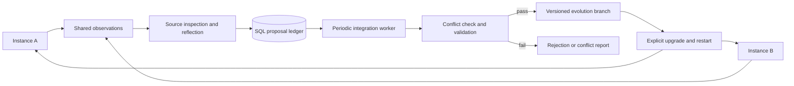

<div align="center">

# EvoMesh

**One instance learns. The whole agent evolves.**

A ready-to-run personal assistant **and** a batteries-included agent framework.
Multi-instance operation. SQLite or MySQL. Evolution across the whole agent stack.

[](https://github.com/wangtaotaotao95/evomesh/actions/workflows/ci.yml)


[中文](README.zh-CN.md) · [Web console](docs/console.md) · [Channels](docs/channels.md) · [Framework guide](docs/framework.md) · [Capability alignment](docs/alignment.md) · [Deployment](docs/deployment.md)

</div>

Agent friction can come from a skill, a missing tool, its soul, the ReAct loop, or any line of implementation code. EvoMesh records that friction, generates source-change proposals, shares them across instances through SQL, and periodically validates and integrates them into a versioned Git branch.

The assistant and framework use **the same `AgentApp` runtime**. Memory, conversations, tools, background tasks, schedules, delegation, and evolution are reusable APIs, not features trapped inside a CLI.

**v0.3 is an alpha, not full Hermes/OpenMuse parity.** It adds a bundled web console and Feishu/Lark, DingTalk and Telegram text channels on top of the durable runtime. Interactive browser takeover, mobile apps, native email/calendar channels, token streaming, and automatic fleet rollout remain gaps. See the [explicit capability matrix](docs/alignment.md).

## Two ways to start

Requires Python 3.11+ and Git. Currently installed from source; no PyPI publication is implied.

```bash
git clone https://github.com/wangtaotaotao95/evomesh.git
cd evomesh
python3 -m venv .venv
source .venv/bin/activate
pip install -e '.[dev,mysql,mcp]'
```

**Personal assistant:**

```bash
evomesh new ../my-assistant --template assistant
cd ../my-assistant
evomesh console  # Open http://127.0.0.1:8765; login token printed in terminal.
# Or: evomesh chat --session main
```

**Agent framework:**

```bash
evomesh new ../my-agent --template framework
cd ../my-agent
python app.py
```

Both generated projects run immediately using a deterministic offline demo, with no model key. The demo lists workspace files; it is not a real LLM. For real reasoning, set `demo = false` in `evomesh.toml`, then configure a tool-capable endpoint:

```bash
export EVOMESH_MODEL='your-tool-capable-model'
export EVOMESH_BASE_URL='https://your-provider.example/v1'
export EVOMESH_API_KEY='your-key'
evomesh chat --session main
```

Secrets stay in environment variables. The CLI discovers `evomesh.toml`, or use `evomesh --config /path/to/evomesh.toml ...`. Relative paths in that file resolve against its directory. [Configuration example](evomesh.example.toml).

## What you can use

| Capability | Personal assistant | Framework API |
|---|---|---|
| Web console | `evomesh console`: chat, tasks, memory, schedules, channels, evolution | `create_server(..., app=app, with_worker=True)` |
| Message channels | Feishu/Lark, DingTalk and Telegram text callbacks/replies | `ChannelHub`, `ChannelAdapter`, atomic SQL inbox/outbox |
| Durable conversations | `chat --session main`, `session show/list --query` | `app.run(..., session=...)`, owner-scoped history |
| Personal memory | `remember/recall/forget` tools; `memory` commands | `app.state.remember/recall/forget` |
| File tools, soul, skills | Loaded from workspace/source config | Normal `Tool` objects and configurable `Agent` |
| Background tasks | `task submit/show/cancel/retry/events` | `app.submit`, `app.work_once`, durable task state |
| Recurring work | `schedule add --every 3600`; task worker | Transactional schedule tick → task queue |
| Progress and control | `run --events`, task event receipts | Event callbacks, cancellation, tool policy hooks |
| Terminal | Opt-in local or restricted Docker backend | `terminal_tool` |
| Public web reading | Explicit HTTPS host allowlist | `web_tool`; text extraction, no JS browser |
| MCP tools | Configured trusted stdio servers | Persistent `MCPConnection`, namespaced `Tool` objects |
| Custom integrations | Trusted plugin modules | `@tool`, `app.register`, replaceable `Model` |
| Delegation | Can expose named specialist apps as a tool | `Team.run`, `Team.as_tool`, bounded parallel work |
| Multi-instance deployment | Task API replicas + workers + MySQL | The same runtime, with SQL leases and namespaces |
| Whole-stack evolution | `reflect`, `worker`, `upgrade` | Source proposals, `Integrator`, Git publication |

## Framework in a few lines

```python
from evomesh import AgentApp, tool


@tool
def word_count(text: str) -> int:
    """Count words."""
    return len(text.split())


with AgentApp.from_config("evomesh.toml", tools=[word_count]) as app:
    app.state.remember("tone", "Prefer concise answers")
    answer = app.run("Help me organize my notes", session="main")
    task_id = app.submit("List workspace files", key="list-request-1")
    app.work_once()
    print(app.state.task(task_id))
```

Use `await app.arun(...)` in asynchronous applications. `Agent` remains the lightweight, in-process building block; `AgentApp` adds configuration, persistence, default tools and task orchestration. See [framework guide](docs/framework.md), [offline example](examples/framework_app.py), and [team example](examples/team.py).

## Work that keeps going

```bash
evomesh task submit 'Summarize the notes in my workspace' --session research --key notes-1
evomesh task-worker                  # Keep running in another terminal.
evomesh task list
evomesh task events TASK_ID
evomesh task cancel TASK_ID          # Stops subsequent steps, not an in-flight external action.
evomesh task retry TASK_ID           # Explicit retry after checking earlier effects.
evomesh schedule add 'Review my notes' --every 3600
```

Tasks, results, events, schedules, memory and completed conversation turns persist in SQL. The task worker must stay running. Expired worker leases mark tasks `interrupted`; unknown external effects are **not automatically replayed**. Schedules coalesce missed intervals into one task, with atomic enqueueing across workers.

## The evolution loop



From an agent **source Git checkout**:

```bash
evomesh observe 'The assistant forgets to summarize saved files'
evomesh reflect --repo .
evomesh proposals
evomesh integrate --repo . --check 'python -m pytest -q'
# Or continuously process proposals:
evomesh worker --repo . --interval 60 --check 'python -m pytest -q'
git diff main..evolution/main
evomesh upgrade --repo .
```

Skills, tools, soul, runtime loop and other tracked UTF-8 code may change. The integration worker uses detached worktrees, lease renewal, file hashes, operator checks, Git compare-and-swap and crash recovery. Running instances adopt code between runs; no mid-turn module replacement. `task-worker` executes user tasks; `worker` integrates evolution proposals.

Generated projects need Git initialization and committed source before reflection. To evolve EvoMesh itself, point `repo` to its source checkout; changing a generated app does not rewrite an installed dependency. [Architecture and consistency contract](docs/architecture.md).

## Deploy or expose an API

```bash
evomesh init
export EVOMESH_SERVER_TOKEN='a-long-random-secret'
evomesh serve --port 8765
# Run separately for background tasks and schedules:
evomesh task-worker
```

Open the bundled console at `http://127.0.0.1:8765/`. `console` starts an embedded worker; `serve` keeps workers separate unless `--with-worker` is specified. Configure channel credentials and sender allowlists in [the channel guide](docs/channels.md).

Authenticated API includes `/run`, `/tasks`, task events/cancel/retry, `/sessions`, `/memory`, and `/schedules`. It uses one server-configured owner, not an owner supplied by the caller. [API reference](docs/api.md).

For a MySQL deployment with two API replicas and a task worker:

```bash
cp .env.example .env
# Fill in model endpoint, keys, tokens and database passwords.
docker compose up --build -d
```

SQLite supports multiple processes on **one host**. MySQL supports cross-host workers. Same-owner replicas need the same workspace/filesystem view; SQL shares records, not file bytes. Integration processes use one canonical Git repository. [Deployment and upgrade guide](docs/deployment.md).

## Trust and current limits

- Persistence is private application data: `AgentApp` saves completed conversations and tool results. Protect the database; owner namespaces are not database-level tenant isolation. Low-level `Agent` remains in-memory.
- Local terminal and MCP servers execute trusted code with host-user permissions. Docker terminal is opt-in, nonroot, network-disabled, resource-limited, and mounts the workspace read-only. It is not an interactive desktop.
- The web tool reads allowlisted text pages. It does not perform browser login, JS execution or takeover; DNS preflight is not a substitute for an egress firewall.
- Detached worktrees are not an OS sandbox. Candidate tests execute code. Use restricted runners and independent evaluation before deploying untrusted proposals.
- Tests validate behavior and consistency, not whether model-written changes improve real task outcomes. Live-provider quality and autonomy benchmarks are not claimed.

## Development and related work

```bash
pip install -e '.[dev,mysql,mcp]'
ruff check .
ruff format --check .
pytest -q
python examples/evolution_demo.py
python examples/framework_app.py
python examples/team.py
```

CI covers SQLite/Python 3.11–3.13, the same suite against real MySQL 8.4, actual MCP subprocesses, package/image builds, and a Docker terminal check. See [CONTRIBUTING](CONTRIBUTING.md), [SECURITY](SECURITY.md), and [roadmap](docs/roadmap.md).

Inspired by [Hermes Agent](https://github.com/NousResearch/hermes-agent) and [OpenMuse](https://github.com/CopilotKit/OpenMuse). EvoMesh's focus is shared whole-stack evolution delivered through both a usable assistant and a reusable framework. This independent repository is not affiliated with other projects named EvoMesh.

MIT. Distribution name: `evomesh-agent`; import and command: `evomesh`.
